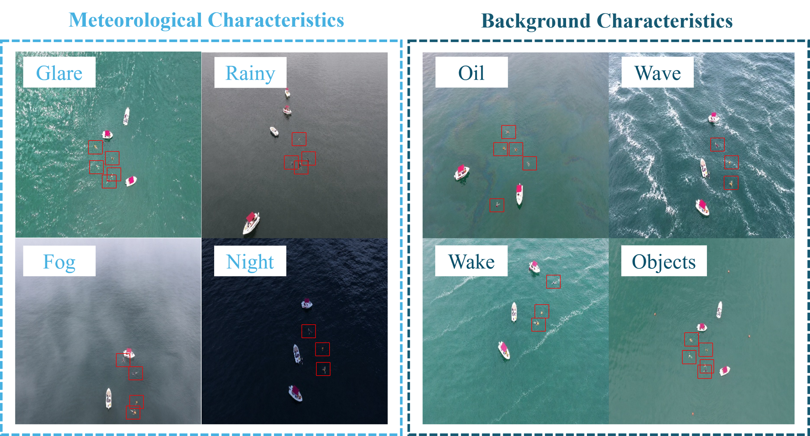

# ADPD-DETR

Adaptive Difference Perception and Knowledge Distillation for UAV-Based Small-Object Detection in Complex Open-Water Environments.

This repository provides a reconstruction-guided teacher, ADPD-DETR and P3-DDPM L-ADPD-DETR students, DRD/TFD/PD training, dataset preparation, COCO evaluation and model profiling.



## Contents

- [Models](#models)
- [Data](#data)
- [Installation](#installation)
- [Training](#training)
- [Evaluation](#evaluation)
- [Model complexity](#model-complexity)
- [Dataset citation](#dataset-citation)
- [License](#license)

## Models

| Model | Configuration under ultralytics/cfg/models/ADPD | Backbone | Difference branch | Feature levels |
|---|---|---|---|---|
| Teacher | ADPD-Teacher-R50.yaml | ResNet-50 | Reconstruction ADPM on P2 | P2–P5 |
| ADPD-DETR | ADPD-DETR-R50.yaml | ResNet-50 | DDPM on P2 | P2–P5 |
| L-ADPD-DETR | L-ADPD-DETR-FasterNet.yaml | FasterNet-based LFENet/LFEB | DDPM on P3 | P3–P5 |

Training reads the class count from the dataset YAML. Teacher and student checkpoints must use the same class layout. Both students use DRD, TFD and PD supervision and deploy the student network alone.

## Data

The Complex Sea-Condition Dataset contains 2,801 images and 10,447 objects, with one detection class, `person_overboard`.

The dataset is published on Mendeley Data as Version 1. Download the three split archives from the dataset page or use the Baidu Netdisk links below. [Mendeley Data dataset DOI](https://doi.org/10.17632/28zjh6bmjv.1).

| Split | Images | Objects | Download | Extraction code |
|---|---:|---:|---|---|
| Train | 1992 | 7427 | [Baidu Netdisk](https://pan.baidu.com/s/1ezwpyF_55x1CSxWu0rnJ8w?pwd=c6zy) | c6zy |
| Validation | 380 | 1353 | [Baidu Netdisk](https://pan.baidu.com/s/1FAapaAyH85IhuMBusiz_yA?pwd=g7n2) | g7n2 |
| Test | 429 | 1667 | [Baidu Netdisk](https://pan.baidu.com/s/16HGiINk9d9mdoXvUzI_2eg?pwd=3sne) | 3sne |

Extract the three archives into the same parent directory. The assembled `formal_complex_sea_public` directory contains `images/{train,val,test}` and `labels/{train,val,test}`. Preserve the partitions and filenames.

```bash
python scripts/verify_dataset.py --data-root /path/to/formal_complex_sea_public
python scripts/prepare_data.py --dataset complex_sea --source-root /path/to/formal_complex_sea_public --output-root prepared_data/complex_sea
```

SeaDronesSee ODv2 data and official crowd-aware validation annotations are prepared as described in [Data access](docs/DATA_ACCESS.md). The default `original` class layout uses six output slots, including reserved slot 0 and five scored foreground categories. Train the teacher and students using the same dataset YAML.

## Installation

The reference environment uses Ubuntu 22.04, Python 3.10, PyTorch 2.3.0 and CUDA 12.1.

```bash
conda env create -f environment.yml
conda activate adpd-detr
```

Run commands from the repository root using the bundled `ultralytics` package.

## Training

The training entries use 100 epochs per stage, 640 input size, batch 4, AdamW, learning rate 1e-4, weight decay 1e-4, seed 42 and disabled Mosaic/MixUp. AMP is disabled by default. Teacher training is followed by separate main-student and lightweight-student distillation runs. See [Training guide](docs/TRAINING.md) for initialization, SeaDronesSee commands and loss settings.

```bash
python scripts/prepare_initialization.py --download --output-root initialization
python scripts/train_teacher.py --data prepared_data/complex_sea/data.yaml --init-weights initialization/teacher_coco.pt --device 0 --name complex_teacher
python scripts/train_adpd_distillation.py --teacher runs/complex_teacher/weights/best.pt --data prepared_data/complex_sea/data.yaml --init-weights runs/complex_teacher/weights/best.pt --device 0 --name complex_main
python scripts/train_l_adpd_distillation.py --teacher runs/complex_teacher/weights/best.pt --data prepared_data/complex_sea/data.yaml --device 0 --name complex_light
```

These commands initialize the teacher from converted COCO weights and the main student from compatible tensors in the trained teacher checkpoint. The P3-DDPM lightweight student uses its model YAML initialization. The trained teacher provides supervision to both students during distillation.

## Evaluation

```bash
python scripts/evaluate.py --weights runs/complex_main/weights/best.pt --data prepared_data/complex_sea/data.yaml --split test --device 0 --output outputs/complex_main_test
python scripts/evaluate.py --weights runs/complex_light/weights/best.pt --data prepared_data/complex_sea/data.yaml --split test --device 0 --output outputs/complex_light_test
python scripts/evaluate.py --weights runs/sea_main/weights/best.pt --data prepared_data/seadronessee/data.yaml --split val --device 0 --output outputs/sea_main_val
python scripts/evaluate.py --weights runs/sea_light/weights/best.pt --data prepared_data/seadronessee/data.yaml --split val --device 0 --output outputs/sea_light_val
```

The output directory receives ground truth, predictions and a metrics JSON. AP, AP50, AP75 and APS are stored as fractions. AP averages IoU thresholds from 0.50 to 0.95 in steps of 0.05. APS uses annotation area in original image coordinates. SeaDronesSee uses official crowd-aware annotations and scores categories 1–5.

ComplexSea evaluation defaults to the held-out test partition. The examples use `--split test` explicitly. Use `--split val` for validation evaluation. The output JSON records the partition actually evaluated. Prepared SeaDronesSee annotations select official validation evaluation; its test scoring uses the benchmark service.

## Model complexity

```bash
python scripts/model_profile.py --model ultralytics/cfg/models/ADPD/ADPD-DETR-R50.yaml --imgsz 640
python scripts/model_profile.py --model ultralytics/cfg/models/ADPD/L-ADPD-DETR-FasterNet.yaml --imgsz 640
```

The tool measures the fused inference model by default and accepts YAML configurations or checkpoints. Results include parameter count, THOP GFLOPs and detection class count.

## Dataset citation

Liu, D., 2026. Complex Sea-Condition Dataset. Mendeley Data, V1. https://doi.org/10.17632/28zjh6bmjv.1.

## License

The modified framework is derived from Ultralytics 8.0.201 under AGPL-3.0. See [LICENSE](LICENSE) and [THIRD_PARTY_NOTICES.md](THIRD_PARTY_NOTICES.md). Follow each dataset's license and citation terms.

The Complex Sea-Condition Dataset is distributed under CC BY 4.0.
